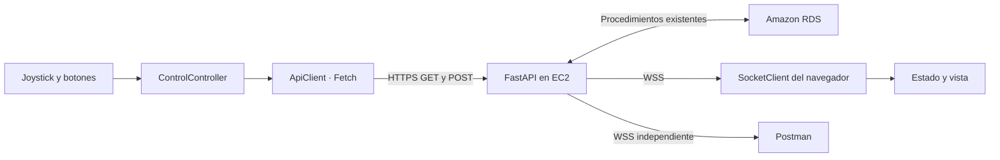

# Control IoT · Máquina de carga

Aplicación web de CONTROL para la actividad 4.1. Usa HTML5, CSS3, Bootstrap 5 y JavaScript con módulos nativos y clases. Consume la API existente en AWS mediante HTTPS y recibe sus eventos mediante WSS.

**Alumno:** Amador Ramírez Jesús Gabriel · 2026.

**Profesor:** Víctor Manuel Pinedo Fernández. **Materia:** Soluciones IoT.

Este frontend está integrado en el proyecto existente `websocket_iot` y se publica desde `main` → `/docs` en el repositorio `Bauliere/vehiculo_Iot`. No necesitas crear otro repositorio.

## Empieza aquí

1. Enciende tu laboratorio, EC2 y la base de datos. Comprueba [la API](https://vehiculo-iot.34-225-114-88.sslip.io/health) y [RDS](https://vehiculo-iot.34-225-114-88.sslip.io/health/rds).
2. Prepara una vez el acceso desde el navegador con [CONFIGURAR_AWS.md](guia/CONFIGURAR_AWS.md). CORS ya respondió correctamente en la comprobación del 9 de noviembre de 2026; no repitas el cambio si ya completaste ese paso.
3. Abre PowerShell en tu laptop. Copia solamente los comandos, sin los signos de los bloques ni el texto `PS C:\...>`:

```powershell
Set-Location 'C:\Users\yolop\Desktop\APInedo\websocket_iot\docs'
py servidor_local.py
```

4. Mantén esa terminal abierta y entra en [http://127.0.0.1:5500](http://127.0.0.1:5500). No abras `index.html` con doble clic: los módulos requieren un servidor HTTP. Si tenías otro servidor en 5500, detenlo con **Ctrl+C** antes de iniciar este y recarga la página con **Ctrl+F5**. `servidor_local.py` sirve los archivos JavaScript con el tipo correcto; en Windows, el servidor genérico puede enviarlos como texto y dejar los controles sin funcionar.
5. En **Acceso de control → Activar control**, introduce solamente el valor de `API_CONTROL_KEY` del `.env` de tu instancia. No escribas `API_CONTROL_KEY=`. Usa preferentemente `API_CONTROL_KEY`. La API también admite la clave de administrador, pero no es necesaria para conducir. Es normal que el campo se vacíe **si aparece «Clave cargada · Pendiente de validar»**: la clave queda únicamente en la memoria de esa pestaña y se valida al enviar una orden. Si se vacía sin esa confirmación y todo sigue bloqueado, revisa el servidor local del paso anterior.
6. Espera el catálogo y los indicadores de API y WSS. Usa el joystick, los botones y una DEMO existente. Al soltar el joystick se solicita DETENER.
7. Sigue [PUBLICAR_GITHUB.md](guia/PUBLICAR_GITHUB.md) para subir este frontend y activar GitHub Pages.
8. Realiza las pruebas de [PRUEBAS.md](guia/PRUEBAS.md).

No necesitas activar el entorno virtual del backend para servir esta página. Detén el servidor local con **Ctrl+C** cuando termines.

La actividad 4.1 se valida con HTTP y eventos WSS. **Mantén apagada la ESP y el control físico durante estas pruebas**: el firmware anterior ya escucha el mismo canal y, si está conectado, puede accionar el carrito.

## Qué hace la aplicación

- Joystick táctil, con mouse y teclado. Resuelve las cuatro direcciones usando los nombres del catálogo real.
- Botones interactivos para subir caja, bajar caja, alternar luces y alternar sonido, habilitados según el catálogo real. Muestran envío, aceptación y evento recibido. Cuando AWS no responde se ven deshabilitados; no envían órdenes ficticias.
- DETENER prioritario: descarta órdenes pendientes y cancela la DEMO conocida antes de detener.
- Consulta, selección, inicio y cancelación de DEMO existentes. AWS ejecuta los pasos y sus tiempos.
- Muestra por separado la solicitud, la aceptación HTTP y el evento WSS recibido.
- Tres indicadores independientes: WebSocket del navegador, API AWS y diagnóstico de RDS.
- Reconexión WSS, tiempos de espera HTTP y mensajes de error sin exponer credenciales.
- Favicon proporcionado por el alumno, créditos al pie y diseño adaptable en verde oscuro.

No incluye historial visual, creación de vehículos, edición de comandos, usuarios ni administración de DEMO. La API y sus procedimientos almacenados siguen en el proyecto `websocket_iot`.

## Archivos y programación orientada a objetos

```text
websocket_iot/docs/
├── index.html                  Estructura y controles accesibles
├── servidor_local.py           Servidor local con tipos correctos para JavaScript y CSS
├── css/styles.css              Diseño y adaptación a pantallas
├── assets/favicon.ico          Favicon proporcionado
├── assets/vendor/              Bootstrap y su licencia
├── js/
│   ├── app.js                  ControlApplication: conecta los componentes
│   ├── config.js               URL pública, vehículo y créditos
│   ├── components/
│   │   ├── joystick.js         Joystick: gestos y teclado
│   │   └── control-view.js     ControlView: representa datos en el DOM
│   ├── controllers/
│   │   └── control-controller.js  ControlController: movimientos, DEMO y prioridad de parada
│   ├── domain/catalog.js      Catalog: valida y resuelve comandos reales
│   ├── services/
│   │   ├── api-client.js       ApiClient: Fetch, autorización y errores HTTP
│   │   ├── socket-client.js    SocketClient: sesión WSS y reconexión
│   │   └── health-service.js   HealthService: comprueba API y RDS por separado
│   ├── state/control-state.js ControlState: estado observable de la interfaz
│   └── utils/errors.js        Errores y validaciones compartidas
├── tests/                     Pruebas automáticas con servicios simulados
├── guia/                      Publicación, configuración y pruebas
├── .gitignore                 Excluye secretos, dependencias y temporales
├── .nojekyll                  Publicación estática sin procesar el sitio con Jekyll
└── package.json               Comando opcional para ejecutar pruebas
```

Cada clase tiene una responsabilidad. La vista muestra información; el controlador coordina órdenes; los servicios se comunican con AWS; `Catalog` valida los datos. Se usa composición: `ControlApplication` conecta estas piezas sin mezclar HTML con consultas a la base de datos.



## Contratos usados

Base HTTPS: `https://vehiculo-iot.34-225-114-88.sslip.io`. Vehículo configurado: `1`.

| Método | Ruta real | Uso |
|---|---|---|
| GET | `/health` | Comprueba la API, sin comprobar RDS |
| GET | `/health/rds` | Comprueba RDS mediante una consulta del backend |
| GET | `/vehiculos/1` | Devuelve vehículo, comandos, estado y DEMO |
| GET | `/vehiculos/1/demos/{id_demo}/movimientos` | Consulta pasos y tiempos del recorrido elegido |
| POST | `/vehiculos/1/movimientos` | Envía `{"id_comando":1,"origen":"API"}` para el ID seleccionado |
| POST | `/vehiculos/1/demos/{id_demo}/iniciar` | Inicia una DEMO, sin cuerpo JSON; responde 202 |
| POST | `/vehiculos/1/demos/{id_demo}/cancelar` | Cancela una DEMO, sin cuerpo JSON; responde 200 |
| WSS | `/ws/vehiculos/1` | Recibe estado inicial y eventos del vehículo |

Las escrituras usan `X-API-Key`. Los IDs se toman de las respuestas del catálogo; no se confunde el ID con el código. En la base actual, 1 avanza, 2 retrocede, 3 gira a la izquierda, 4 a la derecha, 5 sube la caja, 6 la baja, 7 alterna luces, 8 alterna sonido y 9 detiene.

Eventos reales: `estado_inicial`, `movimiento_individual`, `demo_inicio`, `demo_movimiento`, `demo_fin`, `demo_cancelada` y `demo_error`. El estado inicial no vuelve a ejecutar órdenes. Los pasos DEMO no se programan en el navegador ni se agregan al historial individual desde aquí.

## Qué demuestra cada indicador

| Indicador | Evidencia utilizada | Lo que no demuestra |
|---|---|---|
| WebSocket WSS | Apertura, error, cierre y reconexión de esta pestaña | Presencia del microcontrolador o movimiento físico |
| API AWS · 21 servicios | Respuesta de `/health` | Que se hayan ejecutado las 21 operaciones |
| Amazon RDS | Respuesta válida de `/health/rds` | Un fallo de red no basta para afirmar que RDS está caído |

Si no se puede obtener el diagnóstico de RDS, se muestra **Sin verificar**. El estado **No disponible** se atribuye al diagnóstico de RDS solamente cuando la API responde con su error de dependencia reconocido.

## Límites del contrato existente

La API no envía un `request_id` que identifique al navegador autor de cada orden. La interfaz relaciona vehículo, ID, código, nombre y tiempo del evento, pero un evento equivalente de otro cliente podría coincidir. Para la evaluación usa un solo cliente que envíe órdenes y Postman únicamente como observador.

La API tampoco expone una consulta de la DEMO actualmente en ejecución. Si se abre la página a mitad de una DEMO, los eventos siguientes permiten reconocerla; si no llegan, selecciona la DEMO correcta y solicita DETENER. Un conflicto 409 con otra DEMO requiere cancelar la que realmente está activa desde Swagger.

DETENER invalida las órdenes pendientes y se vuelve a enviar si existía un POST en curso. Un timeout de Fetch no revierte una transacción ya recibida por AWS. Si la red se pierde o se cierra la pestaña, no se puede garantizar la llegada de una parada. Esta interfaz no sustituye una parada física ni confirma motores.

## Pruebas y estado de entrega

Las pruebas automáticas se ejecutan con Node.js, sin instalar paquetes:

```powershell
Set-Location 'C:\Users\yolop\Desktop\APInedo\websocket_iot\docs'
node --test tests/*.test.js
```

Validación local realizada: 28 pruebas automáticas aprobadas y prueba de navegador en Edge con REST y WSS simulados. Se comprobaron arrastre, zona neutral, mouse, teclado, gesto táctil emulado, botones, DEMO, parada, recuperación de conexiones, favicon y cinco tamaños de pantalla. No sustituye la prueba en tu teléfono ni contra AWS.

`tests/browser-check.cjs` es una comprobación opcional para desarrollo y requiere Playwright y un navegador compatible. No hace falta instalarlo para abrir ni publicar la aplicación. Sus archivos temporales quedan en `test-results/`, excluidos de Git.

El 9 de noviembre de 2026, las comprobaciones de solo lectura a `/health`, `/health/rds` y `/vehiculos/1` devolvieron 200. WSS entregó `estado_inicial` y CORS respondió correctamente para el origen local y GitHub Pages. Esto no valida la clave ni demuestra el movimiento físico: la prueba completa de órdenes y la publicación se comprueban siguiendo la guía.

Bootstrap 5.3.8 se incluye localmente bajo licencia MIT. No es necesario un proceso de compilación para publicar esta página.


