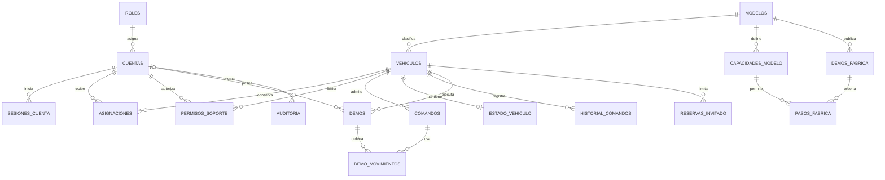

# Actividad 4.3 · Administración IoT

La base de trabajo es el repositorio de CONTROL y MONITOREO. El diagnóstico combina una lectura del código local, el SQL archivado y una consulta de metadatos de solo lectura a la base AWS RDS configurada. Queda por comprobar qué versión sirve EC2, la disponibilidad del respaldo restaurado y las pruebas de roles y vehículo físico.

## Diagnóstico del proyecto

| Situación | Componente | Hallazgo |
| --- | --- | --- |
| Existe y se reutiliza | `docs/index.html`, `docs/assets/js/` | CONTROL tiene joystick, caja, luces, sonido, DETENER y DEMO. MONITOREO usa REST para cargar estado e historial, WSS para eventos y recarga tras reconectar. Tiene indicadores separados para API, RDS y WSS. |
| Existe y se reutiliza | `app/api/routes.py`, `app/services/`, `app/database.py` | FastAPI separa rutas, validación, servicios y acceso a datos. El catálogo interno de SQL admite 21 SP con parámetros y número de argumentos definidos. |
| Se modifica | `app/security.py`, `app/api/public_control.py`, `app/main.py` | Hay claves de API y una sesión pública firmada que dura 15 minutos y limita ciertas escrituras a una unidad. Las lecturas de vehículos y su WSS carecen de identidad y permiso sobre el recurso. Esa sesión tampoco reserva una unidad en exclusiva. |
| Se modifica | Contratos de vehículos, DEMO, historial y WSS | Conservar los formatos que usa el frontend. Agregar autorización por unidad, limitar el catálogo según el rol, revocar suscripciones al perder permisos y priorizar DETENER. Las claves globales no representan a un comprador. |
| Se crea | Administración, acceso por rol y reserva comercial | Gestión de modelos, unidades y clientes, asignaciones, sesiones de invitado, auditoría y editor de recorridos según propietario y capacidades. La interfaz comercial necesita datos persistidos. |

Flujo actual. GitHub Pages sirve `docs/`. El navegador usa HTTPS y WSS contra EC2. Caddy reenvía a FastAPI en `127.0.0.1:8000` en el despliegue documentado. FastAPI consulta MySQL mediante PyMySQL y publica eventos por unidad. El navegador y la ESP consumen el canal de su vehículo. `conectado` en el estado es un dato persistido y `WSS en línea` indica que se abrió el canal del cliente. La ejecución física requiere observación directa o telemetría reportada por firmware.

## REST observado

El catálogo base contiene **23 operaciones HTTP para 21 SP**. Un endpoint puede consultar varios SP y varios endpoints pueden reutilizar el mismo. Las rutas de salud, sesión pública y Fausto.IA se añaden a ese catálogo. En la tabla, `V` significa `/vehiculos/{id_vehiculo}`, `C` significa `V/comandos/{id_comando}`, `D` significa `V/demos/{id_demo}` y `P` significa `D/movimientos/{id_demo_movimiento}`. Los IDs de ruta son enteros positivos.

| Método y ruta | Entrada | Respuesta normal | Autorización actual |
| --- | --- | --- | --- |
| `GET /vehiculos` | — | 200, lista de vehículos | Pública |
| `GET V` | ID vehículo | 200, `{vehiculo, comandos, estado, demos}` | Pública |
| `POST /vehiculos` | Vehículo | 201, vehículo | Admin |
| `POST V/actualizar` | Vehículo + `activo` | 200, vehículo actualizado | Admin |
| `POST V/eliminar` | ID vehículo | 200, `{mensaje,recurso,id}` | Admin |
| `GET V/comandos` | ID vehículo | 200, lista de comandos | Pública |
| `POST V/comandos` | Comando | 201, comando | Admin |
| `POST C/actualizar` | Comando + `activo` | 200, comando actualizado | Admin |
| `POST C/eliminar` | IDs de vehículo y comando | 200, `{mensaje,recurso,id}` | Admin |
| `GET V/estado` | ID vehículo | 200, estado o `null` | Pública |
| `POST V/movimientos` | `id_comando`, `origen` opcional | 200, aceptación y estado persistido | Control, admin o sesión pública habilitada para V |
| `GET V/historial` | ID vehículo | 200, hasta diez movimientos individuales | Pública |
| `GET V/demos` | ID vehículo | 200, lista de demos | Pública |
| `GET D` | IDs de vehículo y demo | 200, demo | Pública |
| `POST V/demos` | Demo | 201, demo | Admin |
| `POST D/actualizar` | Demo + `activo` | 200, demo actualizada | Admin |
| `POST D/eliminar` | IDs de vehículo y demo | 200, `{mensaje,recurso,id}` | Admin |
| `GET D/movimientos` | IDs de vehículo y demo | 200, pasos por orden | Pública |
| `POST D/movimientos` | Paso | 201, paso | Admin |
| `POST P/actualizar` | Paso | 200, paso actualizado | Admin |
| `POST P/eliminar` | IDs de vehículo, demo y paso | 200, `{mensaje,recurso,id}` | Admin |
| `POST D/iniciar` | IDs de vehículo y demo | 202, aceptación | Control, admin o sesión pública habilitada para V |
| `POST D/cancelar` | IDs de vehículo y demo | 200, cancelación | Control, admin o sesión pública habilitada para V |

| Cuerpos y resultados | Campos |
| --- | --- |
| Vehículo | `nombre`, `modelo`, `descripcion`, `microcontrolador`. La respuesta agrega `id_vehiculo`, `fecha_registro` y `activo`. `modelo` es texto en el esquema actual. |
| Comando | `nombre`, `codigo`, `descripcion`. La respuesta agrega `id_comando`, `id_vehiculo` y `activo`. `codigo` es el valor para el firmware y `id_comando` identifica la fila. |
| DEMO | `nombre`, `descripcion`. La respuesta agrega `id_demo`, `id_vehiculo` y `activo`. |
| Paso de DEMO | `id_comando`, `orden`, `duracion_ms` y `pausa_ms`. La respuesta agrega `id_demo_movimiento`, `comando` y `codigo`. `orden` es único dentro de la demo. |
| Movimiento | Ejemplo documentado `{"id_comando":1,"origen":"API"}`. La respuesta incluye `mensaje`, `id_vehiculo`, `id_comando`, `origen` y `estado`. |
| Estado | `id_vehiculo`, `vehiculo`, `id_comando`, `comando`, `codigo`, `conectado`, `fecha_actualizacion`. |
| Historial | `id_historial`, `id_vehiculo`, `comando`, `codigo`, `fecha_hora`, `origen`. |

Los cuerpos usan enteros estrictos para IDs, códigos, duraciones y banderas `0`/`1`. Las respuestas de error incluyen 401 por credencial ausente o inválida, 403 por operación fuera del permiso, 404 por recurso inexistente o ajeno según la ruta, 409 por duplicado, estado incompatible o referencia, 422 por validación, 500 por error interno y 503 por configuración o base indisponible. Algunas operaciones usan 400 para incompatibilidad de datos. Swagger detalla los estados expuestos por ruta.

`GET /health` responde por el servidor sin consultar la base. `GET /health/rds` ejecuta una lectura con `sp_obtener_vehiculos`. `GET /control/sesion` emite `token`, `expires_in` e `id_vehiculo` cuando esa modalidad está habilitada. Fausto.IA usa `POST V/fausto/interpretar` con `texto` o con `audio` en Base64 y `mime`, además de `POST V/fausto/{plan_id}/ejecutar`, `/cancelar` y `/confirmar`. La confirmación de cambios de catálogo requiere administración.

CONTROL reutiliza la ficha y el catálogo, los movimientos y el inicio, consulta y cancelación de demos. MONITOREO reutiliza estado, historial y ambos diagnósticos. ADMINISTRACIÓN podrá reutilizar los contratos de vehículo, comando, demo y paso con los controles por recurso correspondientes. Los servicios nuevos serán cuentas y sesiones, modelos y capacidades, asignaciones y soporte, reserva de exhibición y auditoría. Al definir las rutas, deja las operaciones propuestas fuera de Swagger hasta que existan y tengan pruebas.

## WebSocket e historial

- Canal observado `WSS /ws/vehiculos/{id_vehiculo}`. El backend comprueba ID positivo y existencia antes de suscribir. Recibe texto del cliente sin interpretarlo como un movimiento. El firmware y el navegador escuchan eventos. El código actual no autentica la suscripción ni mide presencia del dispositivo por tipo de cliente.
- Formato común `tipo`, `id_vehiculo`, `comando`, `codigo` y `timestamp` ISO en UTC. `estado_inicial` entrega `estado`. `movimiento_individual` añade ID de comando, origen y estado al completar la transacción. Los eventos de DEMO son `demo_inicio`, `demo_movimiento`, `demo_fin`, `demo_cancelada` y `demo_error`. El paso incluye IDs, `orden`, `duracion_ms`, `pausa_ms` y `estado`. Fausto.IA puede añadir `fausto_id`. El servidor espera duración más pausa entre pasos. El evento terminal documenta el cierre del recorrido.
- Los movimientos individuales actualizan estado y guardan historial antes de publicar. Las DEMO actualizan estado y publican cada paso. MONITOREO reserva la tabla para la respuesta de `GET /historial`, que excluye origen DEMO y limita a diez filas por `fecha_hora` e `id_historial` descendentes. El último evento puede corresponder a una DEMO sin aparecer en esa tabla.
- El cliente ya reintenta WSS y vuelve a leer REST tras reconectar. En 4.3 el cambio de unidad deberá cerrar el canal anterior, descartar respuestas en vuelo de esa unidad y validar la nueva suscripción. El permiso deberá revisarse al reasignar, expirar o cerrar sesión. Una credencial breve de canal vinculada a identidad, unidad y finalidad permite separar el navegador del firmware. Verificar el mecanismo con la ESP y un cliente independiente antes de cerrar el canal antiguo.

## Esquema confirmado y propuesta

El inventario de solo lectura por TLS confirmó el esquema `vehiculo_iot` en MySQL 8.4.9. Hay seis tablas InnoDB con `utf8mb4_0900_ai_ci`, 34 columnas, 18 componentes de índices, ocho FK, 21 SP y ningún disparador visible. Los conteos de parámetros de las rutinas coinciden con el catálogo de FastAPI. La consola de AWS identifica el tipo exacto de recurso y permite elegir el procedimiento de respaldo apropiado. Confirma allí si es un clúster Aurora o una instancia RDS antes de tomar el snapshot.

Los antecedentes se encuentran en `apoyo/docs/CONTRATO_RDS.md`, `apoyo/anteriores/sql/vehiculo_iot_rds_corregido.sql` y `apoyo/scripts/comprobar_rds.sql`. `apoyo/` está fuera de Git. El SQL archivado coincide con los nombres de tablas y las reglas clave observadas en el inventario actual. Usa una copia restaurada para validar las rutinas y comprobar la migración.

- `C:\Users\yolop\Desktop\inventario-rds-4-3.json` contiene metadatos, índices y firmas de procedimientos, sin filas de negocio ni definidores.
- `C:\Users\yolop\Desktop\esquema-rds-4-3.sql` contiene las seis tablas y 21 rutinas obtenidas con `SHOW CREATE`, sin datos, definidores ni contadores `AUTO_INCREMENT`. Úsalo como referencia de estructura. La recuperación de datos requiere el snapshot.

| Tabla observada | Llaves y reglas relevantes |
| --- | --- |
| `vehiculos` | `id_vehiculo` INT autoincremental y PK. Modelo como texto. |
| `comandos` | PK `id_comando` y FK a vehículo. Únicos por vehículo para nombre y código. |
| `demos` | PK `id_demo` y FK a vehículo. No hay dueño ni clasificación comercial en el DDL observado. |
| `demo_movimientos` | PK `id_demo_movimiento`, FK a demo y comando y restricción única `(id_demo,orden)`. El servicio comprueba que demo y comando pertenezcan al mismo vehículo. |
| `estado_vehiculo` | PK `id_estado`, FK y unicidad de `id_vehiculo`, FK nullable a comando. |
| `historial_comandos` | PK `id_historial` BIGINT, FK a vehículo y FK nullable a comando. El límite de diez se aplica en API. |

| Función | Procedimientos observados |
| --- | --- |
| Vehículos | `sp_obtener_vehiculos`, `sp_obtener_vehiculo`, `sp_crear_vehiculo`, `sp_actualizar_vehiculo`, `sp_eliminar_vehiculo` |
| Comandos | `sp_obtener_comandos_vehiculo`, `sp_crear_comando`, `sp_actualizar_comando`, `sp_eliminar_comando` |
| Estado e historial | `sp_obtener_estado`, `sp_actualizar_estado`, `sp_obtener_historial`, `sp_registrar_historial` |
| Demos | `sp_obtener_demos`, `sp_crear_demo`, `sp_actualizar_demo`, `sp_eliminar_demo` |
| Pasos | `sp_obtener_movimientos_demo`, `sp_agregar_movimiento_demo`, `sp_actualizar_movimiento_demo`, `sp_eliminar_movimiento_demo` |

Las FK verificadas aplican `CASCADE` sobre comandos, demos, estado e historial al borrar un vehículo, y sobre pasos al borrar una demo. Si se intenta borrar un comando usado en un paso, se aplica `RESTRICT`. Cuando se borra un comando permitido, las referencias de estado e historial quedan en `NULL`. Las bajas comerciales deben usar estado inactivo y preservar IDs. Antes de incorporar auditoría y asignaciones, revisar especialmente los accesos a `sp_eliminar_vehiculo` y `sp_eliminar_comando` y conservar la lectura de registros existentes.

Relaciones propuestas, sujetas al DDL observado en la copia de prueba.



- Mantener `vehiculos.id_vehiculo` para las integraciones existentes. Añadir identificador físico único, modelo relacionado y estado comercial `disponible`, `vendida`, `exhibicion` o `inactiva`. Incorporar columnas opcionales primero. Completar el catálogo y verificar el mapeo antes de exigir campos.
- Cada unidad admite como máximo una asignación activa. Conservar intervalos y auditoría de cada cambio. Resolver la exclusividad con fila única activa por unidad o bloqueo de su fila y verificación transaccional. El permiso de soporte identifica unidad, administrador autorizado y caducidad y puede revocarse. Roles, propiedad y soporte se verifican en el servidor.
- Las capacidades por modelo son únicas por `(modelo, codigo)` y se corresponden con el catálogo activo de cada unidad. Reutilizar demos y pasos de unidad para recorridos privados. Los de fábrica por modelo guardan capacidad, orden y tiempos, y se resuelven contra el comando compatible de la unidad al ejecutar. El editor debe validar la secuencia completa en una transacción, con límites de tiempo y concurrencia.
- La reserva de exhibición se toma y libera de forma atómica por unidad. Debe aplicar la misma exclusión a invitados y operadores autorizados. Validar vencimiento, unidad, comando y límites en cada acción. Probar DETENER al expirar o perder conexión. Un watchdog local del dispositivo acota la última orden activa si la red no permite recibir la parada.
- La auditoría registra actor o sesión de invitado, acción, recurso, resultado y fecha UTC. Indexar los filtros de unidad, fecha, actor y asignación. Guardar identificadores de sesión revocables y credenciales protegidas. Mantener contraseñas, claves y tokens fuera de eventos, logs y Git.

## Respaldo, entorno de prueba y transición

### Migración 001 · Modelos y unidades

`migrations/4_3/001_modelos_unidades.up.sql` agrega el catálogo `modelos_vehiculo` y enlaza `vehiculos` sin cambiar sus IDs ni el campo `modelo` que lee la API actual. El identificador físico es único. Las columnas nuevas admiten `NULL` para que las filas existentes y las altas del procedimiento anterior sigan funcionando. La clasificación y asignación de unidades requieren datos confirmados.

En una instancia local desechable de MySQL 8.0.45, se importó el DDL capturado de RDS y se verificó la migración con un alta anterior y otra posterior mediante `sp_crear_vehiculo`. Coincidieron los conteos previos y posteriores a la migración, los identificadores existentes y los 21 procedimientos. Se comprobaron rechazos por serie duplicada, modelo inexistente y serie en blanco. Esta validación usó datos de prueba. La siguiente validación se realiza sobre una copia restaurada del recurso AWS, con el motor y los datos del entorno objetivo.

Con el esquema de la copia seleccionado en Workbench, ejecuta `001_modelos_unidades.verify.sql`, guarda el resultado, ejecuta `001_modelos_unidades.up.sql` una sola vez y repite la verificación. Si falla la migración, conserva el log y descarta la copia de prueba o recupérala desde el snapshot. Ese proceso también cubre un fallo tras el primer DDL y evita quitar columnas que ya puedan contener datos. La fase de aplicación en el recurso original sigue pendiente.

1. Anota el commit base y verifica `git status --short`. Desde AWS identifica el recurso de origen, versión y esquema usando el acceso administrativo disponible. Para Aurora, crea un snapshot de clúster. Para una instancia RDS MySQL, crea el snapshot de la instancia. Espera el estado `Available` y conserva la exportación de estructura separada. [Crear un snapshot de Aurora](https://docs.aws.amazon.com/AmazonRDS/latest/AuroraUserGuide/USER_CreateSnapshotCluster.html) · [Crear un snapshot de instancia RDS](https://docs.aws.amazon.com/AmazonRDS/latest/UserGuide/USER_CreateSnapshot.html).
2. Restaura el snapshot en un entorno de prueba aislado. Conserva en EC2 el `.env` y la tarea originales. Arranca una copia del backend apuntando a la base de prueba, con variables exclusivas, puerto distinto y acceso restringido. Usa la ESP simulada o un consumidor WSS de prueba sin salidas físicas. [Restaurar un snapshot de Aurora](https://docs.aws.amazon.com/AmazonRDS/latest/AuroraUserGuide/aurora-restore-snapshot.html) · [Restaurar un snapshot de instancia RDS](https://docs.aws.amazon.com/AmazonRDS/latest/UserGuide/USER_RestoreFromSnapshot.html).
3. Desde la raíz del repositorio, extrae solo metadatos hacia el Escritorio con el comando siguiente. La herramienta usa la conexión TLS definida para el backend, así que comprueba primero que el entorno apunta al clúster que quieres inventariar. Este inventario complementa el snapshot y la exportación de estructura.

   ```powershell
   .\.venv\Scripts\python.exe -m tools.inventario_rds_4_3 | Set-Content -Encoding UTF8 "$env:USERPROFILE\Desktop\inventario-rds-4-3.json"
   ```

   También puedes ejecutar estas consultas en Workbench contra el esquema de prueba seleccionado. Obtén después `SHOW CREATE TABLE` por tabla y `SHOW CREATE PROCEDURE` por rutina y revisa sus definidores, parámetros e índices. Compara conteos de las seis tablas y registra los IDs que usan CONTROL y MONITOREO.

   ```sql
   SELECT DATABASE() AS esquema, @@version AS version_motor;
   SHOW FULL TABLES;
   SELECT TABLE_NAME, CONSTRAINT_NAME, CONSTRAINT_TYPE
   FROM information_schema.TABLE_CONSTRAINTS
   WHERE TABLE_SCHEMA = DATABASE()
   ORDER BY TABLE_NAME, CONSTRAINT_NAME;
   SELECT TABLE_NAME, INDEX_NAME, NON_UNIQUE, SEQ_IN_INDEX, COLUMN_NAME
   FROM information_schema.STATISTICS
   WHERE TABLE_SCHEMA = DATABASE()
   ORDER BY TABLE_NAME, INDEX_NAME, SEQ_IN_INDEX;
   SELECT ROUTINE_NAME, ROUTINE_TYPE
   FROM information_schema.ROUTINES
   WHERE ROUTINE_SCHEMA = DATABASE()
   ORDER BY ROUTINE_NAME;
   ```

4. Versiona SQL por estructura nueva, columnas e índices compatibles, carga de datos existentes, verificación y recuperación. Aplica en la copia, valida los SP actuales, compara conteos e IDs y prueba los escenarios de aislamiento. El DDL puede confirmar cambios implícitamente. La recuperación se prueba restaurando una copia o ejecutando una corrección compatible y revisada.
5. Publica por etapas al superar las pruebas. Mantén el identificador de unidad y el protocolo necesarios para la ESP. Restringe la sesión pública antigua antes de exponer inventario privado y comprueba en Swagger que el API que sirve EC2 corresponde al commit esperado. Documenta la versión SQL y el resultado aplicado.

## Diseño propuesto para las tres vistas

Las vistas comparten navegación, paletas, favicon y créditos. El selector de unidad se coloca antes de cualquier acción sobre el vehículo y los tres indicadores de conectividad ocupan el mismo sitio cuando aplican. En teléfono, CONTROL conserva la pantalla fija y sus zonas táctiles. Los listados, formularios y el editor de Administración pueden desplazarse dentro de sus vistas.

| Vista | Orden de lectura y acciones por rol |
| --- | --- |
| CONTROL | El comprador selecciona «Mis vehículos», ve qué unidad está activa y opera sus controles compatibles y DETENER. Después accede a sus recorridos. El administrador solo ve el control operativo de una unidad vendida si se le concedió permiso explícito de soporte. El invitado entra por el catálogo y tiene una vista de prueba con tiempo restante, comandos permitidos y DETENER. |
| MONITOREO | Selector de unidad, conectividad, tarjeta del último movimiento o evento y tabla de hasta diez individuales. El comprador y las sesiones de soporte pueden ver la unidad autorizada. El invitado ve únicamente información necesaria para su sesión de exhibición. |
| ADMINISTRACIÓN | El administrador empieza con indicadores reales y luego inventario, modelos y capacidades, clientes, asignaciones, demos de fábrica y auditoría. Los formularios se abren en el contexto de la lista. «Mis vehículos» y las demos privadas tienen acceso desde la sesión del comprador. El invitado se queda en el catálogo y la reserva de exhibición. |

En el editor táctil, el nombre y la unidad o el modelo aparecen primero, seguidos por la duración total. Cada paso tiene orden, comando permitido, duración, pausa y acciones «Subir», «Bajar» y «Quitar». Los controles de orden sirven con dedo y teclado. «Agregar paso» y «Guardar» deben quedar visibles, y los errores deben aparecer junto al valor inválido. Al editar, conserva los cambios locales hasta que el guardado se confirme.

El enunciado pide coherencia visual y accesibilidad. Se puede reutilizar el movimiento suave de tarjetas y el holograma de Fausto como decoración discreta en resúmenes. El efecto se pausa con `prefers-reduced-motion` y se omite en formularios, tablas, cronómetro y DETENER para que los datos y controles mantengan posición y contraste.

Quedan por confirmar las cuentas o proveedor de identidad que se usarán, qué unidad es de exhibición, cuáles pueden asignarse, y la lista de comandos y tiempos permitidos para la prueba física. Con esos datos, los puntos de cambio serían `app/api/` y `app/security.py` para acceso, `app/services/` para permisos y reglas, una carpeta SQL versionada para migraciones y `docs/assets/` más `docs/index.html` para la navegación, Administración y el editor.

## Evidencias y pendientes de actividad

La matriz siguiente parte de **No ejecutado** para la validación 4.3 en infraestructura. Las pruebas necesitan cuentas de demostración y al menos una unidad de comprador y otra de exhibición en la copia de prueba. Usa usuarios A y B para comprobar aislamiento y dos clientes simultáneos para comprobar la reserva. Registra URL, fecha, resultado y evidencia sin secretos.

| Prueba | Criterio y evidencia |
| --- | --- |
| P01 · Login Admin | Iniciar y cerrar sesión con cuenta de prueba. Comprobar expiración. |
| P02 · Alta de unidad | Crear unidad con identificador físico único; comprobar duplicado e inventario. |
| P03 · Alta de cliente | Registrar comprador y comprobar que aparece en clientes. |
| P04 · Asignación | Asignar y reasignar; comprobar historial y revocación previa. |
| P05 · Aislamiento | Mostrar únicamente las unidades del comprador conectado. |
| P06 · Control | Confirmar comando permitido y DETENER, con respuestas HTTP y estado observado. |
| P07 · WSS | Recibir eventos en cliente externo y otra pestaña autorizada; comprobar cierre al revocar acceso. |
| P08 · Historial | Con más de diez individuales, comprobar únicamente los diez recientes y el orden. |
| P09 · Demo persistente | Guardar pasos, reabrir desde otra sesión y revisar orden y tiempos. |
| P10 · Ejecución y cancelación | Ver inicio, pasos y terminal; comprobar que DETENER interrumpe y que no cambió la tabla de movimientos por pasos internos. |
| P11 · Invitado | Abrir catálogo, reservar exhibición y comprobar expiración y liberación. |
| P12 · Invitado contra Admin | Comprobar rechazo en una ruta administrativa con token de invitado. |
| P13 · Vehículo ajeno | Comprobar que REST y WSS del comprador A rechazan el recurso de B. |
| P14 · Exclusividad | Intentar dos reservas sobre la misma unidad y comprobar que solo una la opera. |
| P15 · Reconexión | Interrumpir WSS y comprobar carga REST al volver, con salud API y RDS verificada por separado. |
| P16 · Responsive | Revisar móvil vertical y horizontal y escritorio, teclado, foco y lectura del historial. |
| P17 · Auditoría | Comprobar actor, acción, unidad, fecha y resultado tras operaciones de prueba. |

Cada integrante presenta su plataforma. En las tres rondas rota quién actúa como administrador, comprador e invitado. Las capturas deben incluir navegación y URL publicadas, Swagger, respaldo/migración, autorización REST y WSS, persistencia del historial y resultados de la matriz. La prueba física se registra durante una ejecución supervisada, con el vehículo identificado.
