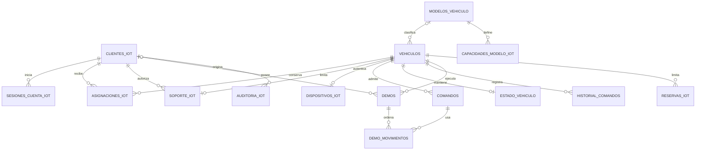

# Actividad 4.3 · Administración IoT

La actividad parte del commit `f4b34a8` de CONTROL y MONITOREO. En AWS se observaron 30 operaciones HTTP, incluido el catálogo base de 23 operaciones sobre 21 procedimientos. Se comprobó `/health/rds`, la ficha de la unidad 1, sus nueve comandos, estado, diez filas de historial, una DEMO con siete pasos y `estado_inicial` con un cliente WebSocket independiente. La rama 4.3 añade 26 operaciones documentadas en Swagger.

[Comandos de despliegue y respaldo](DESPLEGAR_4_3.md)

## Diagnóstico del proyecto

| Situación | Componente | Hallazgo |
| --- | --- | --- |
| Existe y se reutiliza | `docs/index.html`, `docs/assets/js/` | CONTROL tiene joystick, caja, luces, sonido, DETENER y DEMO. MONITOREO usa REST para cargar estado e historial, WSS para eventos y recarga tras reconectar. Tiene indicadores separados para API, RDS y WSS. |
| Existe y se reutiliza | `app/api/routes.py`, `app/services/`, `app/database.py` | FastAPI separa rutas, validación, servicios y acceso a datos. El catálogo interno de SQL admite 21 SP con parámetros y número de argumentos definidos. |
| Se modifica | `app/security.py`, `app/api/public_control.py`, `app/main.py` | Hay claves de API y una sesión pública firmada que dura 15 minutos y limita ciertas escrituras a una unidad. Las lecturas de vehículos y su WSS carecen de identidad y permiso sobre el recurso. Esa sesión tampoco reserva una unidad en exclusiva. |
| Se modifica | Contratos de vehículos, DEMO, historial y WSS | Conservar los formatos que usa el frontend. Agregar autorización por unidad, limitar el catálogo según el rol, revocar suscripciones al perder permisos y priorizar DETENER. Las claves globales no representan a un comprador. |
| Se crea | Administración, acceso por rol y reserva comercial | Gestión de modelos, unidades y clientes, asignaciones, sesiones de invitado, auditoría y editor de recorridos según propietario y capacidades. La interfaz comercial necesita datos persistidos. |

Flujo actual. GitHub Pages sirve `docs/`. El navegador usa HTTPS y WSS contra EC2. Caddy reenvía a FastAPI en `127.0.0.1:8000` en el despliegue documentado. FastAPI consulta MySQL mediante PyMySQL y publica eventos por unidad. El navegador y la ESP consumen el canal de su vehículo. `conectado` en el estado es un dato persistido y `WSS en línea` indica que se abrió el canal del cliente. La ejecución física requiere observación directa o telemetría reportada por firmware.

## REST observado

El catálogo base contiene **23 operaciones HTTP para 21 SP**. La autorización de la tabla corresponde al despliegue anterior que se auditó. `V` significa `/vehiculos/{id_vehiculo}`, `C` significa `V/comandos/{id_comando}`, `D` significa `V/demos/{id_demo}` y `P` significa `D/movimientos/{id_demo_movimiento}`. Los IDs de ruta son enteros positivos.

| Método y ruta | Entrada | Respuesta normal | Autorización actual |
| --- | --- | --- | --- |
| `GET /vehiculos` | — | 200, lista de vehículos | Pública |
| `GET V` | ID vehículo | 200, `{vehiculo, comandos, estado, demos}` | Pública |
| `POST /vehiculos` | Vehículo | 201, vehículo | Admin |
| `POST V/actualizar` | Vehículo + `activo` | 200, vehículo actualizado | Admin |
| `POST V/eliminar` | ID vehículo | 200, `{mensaje,recurso,id}` | Admin |
| `GET V/comandos` | ID vehículo | 200, lista de comandos | Pública |
| `POST V/comandos` | Comando | 201, comando | Admin |
| `POST C/actualizar` | Comando + `activo` | 200, comando actualizado | Admin |
| `POST C/eliminar` | IDs de vehículo y comando | 200, `{mensaje,recurso,id}` | Admin |
| `GET V/estado` | ID vehículo | 200, estado o `null` | Pública |
| `POST V/movimientos` | `id_comando`, `origen` opcional | 200, aceptación y estado persistido | Control, admin o sesión pública habilitada para V |
| `GET V/historial` | ID vehículo | 200, hasta diez movimientos individuales | Pública |
| `GET V/demos` | ID vehículo | 200, lista de demos | Pública |
| `GET D` | IDs de vehículo y demo | 200, demo | Pública |
| `POST V/demos` | Demo | 201, demo | Admin |
| `POST D/actualizar` | Demo + `activo` | 200, demo actualizada | Admin |
| `POST D/eliminar` | IDs de vehículo y demo | 200, `{mensaje,recurso,id}` | Admin |
| `GET D/movimientos` | IDs de vehículo y demo | 200, pasos por orden | Pública |
| `POST D/movimientos` | Paso | 201, paso | Admin |
| `POST P/actualizar` | Paso | 200, paso actualizado | Admin |
| `POST P/eliminar` | IDs de vehículo, demo y paso | 200, `{mensaje,recurso,id}` | Admin |
| `POST D/iniciar` | IDs de vehículo y demo | 202, aceptación | Control, admin o sesión pública habilitada para V |
| `POST D/cancelar` | IDs de vehículo y demo | 200, cancelación | Control, admin o sesión pública habilitada para V |

| Cuerpos y resultados | Campos |
| --- | --- |
| Vehículo | `nombre`, `modelo`, `descripcion`, `microcontrolador`. La respuesta agrega `id_vehiculo`, `fecha_registro` y `activo`. `modelo` es texto en el esquema actual. |
| Comando | `nombre`, `codigo`, `descripcion`. La respuesta agrega `id_comando`, `id_vehiculo` y `activo`. `codigo` es el valor para el firmware y `id_comando` identifica la fila. |
| DEMO | `nombre`, `descripcion`. La respuesta agrega `id_demo`, `id_vehiculo` y `activo`. |
| Paso de DEMO | `id_comando`, `orden`, `duracion_ms` y `pausa_ms`. La respuesta agrega `id_demo_movimiento`, `comando` y `codigo`. `orden` es único dentro de la demo. |
| Movimiento | Ejemplo documentado `{"id_comando":1,"origen":"API"}`. La respuesta incluye `mensaje`, `id_vehiculo`, `id_comando`, `origen` y `estado`. |
| Estado | `id_vehiculo`, `vehiculo`, `id_comando`, `comando`, `codigo`, `conectado`, `fecha_actualizacion`. |
| Historial | `id_historial`, `id_vehiculo`, `comando`, `codigo`, `fecha_hora`, `origen`. |

Los cuerpos usan enteros estrictos para IDs, códigos, duraciones y banderas `0`/`1`. Las respuestas de error incluyen 401 por credencial ausente o inválida, 403 por operación fuera del permiso, 404 por recurso inexistente o ajeno según la ruta, 409 por duplicado, estado incompatible o referencia, 422 por validación, 500 por error interno y 503 por configuración o base indisponible. Algunas operaciones usan 400 para incompatibilidad de datos. Swagger detalla los estados expuestos por ruta.

`GET /health` responde por el servidor sin consultar la base. `GET /health/rds` ejecuta una lectura con `sp_obtener_vehiculos`. `GET /control/sesion` emite `token`, `expires_in` e `id_vehiculo` cuando esa modalidad está habilitada. Fausto.IA usa `POST V/fausto/interpretar` con `texto` o con `audio` en Base64 y `mime`, además de `POST V/fausto/{plan_id}/ejecutar`, `/cancelar` y `/confirmar`. La confirmación de cambios de catálogo requiere administración.

CONTROL reutiliza la ficha, el catálogo, los movimientos y las rutas de ejecución de demos. MONITOREO conserva estado, historial y ambos diagnósticos. En modo comercial las lecturas de unidad y DEMO, las órdenes y el WSS requieren permiso sobre la unidad. `GET /control/sesion` y las escrituras de inventario antiguas quedan deshabilitadas en ese modo. Los formularios comerciales guardan usando estos contratos nuevos, bajo `/plataforma`.

| Operaciones | Permiso y entrada | Respuesta |
| --- | --- | --- |
| `GET /config`, `GET /catalogo` | Público. El catálogo pagina con `limit` y `offset`. | Modo activo o modelos públicos con capacidad y disponibilidad. |
| `POST /sesion`, `DELETE /sesion` | Cuenta por correo y contraseña. Bearer para cerrar. | 201 con cuenta y token, o 204 con revocación. |
| `GET/POST /modelos`, `GET/PUT /modelos/{id}` | Administrador. Filtro `q`. Nombre, descripción, foto HTTPS, activo y capacidades `{nombre,codigo,exhibicion}`. | Lista de modelos o modelo con su catálogo. |
| `GET/POST /unidades`, `PUT /unidades/{id}` | Administrador. Filtros `q` y `estado`. Nombre, serie, `id_modelo`, estado, descripción y microcontrolador. | Inventario, alta o edición de una unidad física. |
| `GET/POST /clientes`, `PUT /clientes/{id}` | Administrador. Filtro `q`. Nombre, correo, activo y contraseña inicial o nueva. | Cuenta de comprador. |
| `PUT /unidades/{id}/asignacion`, `PUT /unidades/{id}/soporte`, `GET /mis-unidades` | Administrador asigna `id_cliente` o `null`. Comprador propio envía `autorizado`. Cada cuenta consulta sus unidades operables. | Unidad asignada, plazo de soporte o lista operable. |
| `GET/POST /unidades/{id}/editor`, `GET/PUT /unidades/{id}/editor/{demo_id}` | Administrador edita demos de empresa. Comprador edita las suyas en unidades propias. | Cabecera y pasos ordenados en una sola escritura. Ejemplo de paso `{"id_comando":1,"duracion_ms":500,"pausa_ms":0}`. |
| `GET /dashboard`, `GET /auditoria` | Administrador. Auditoría pagina con `limit` y `offset`. | Totales, conexiones autenticadas y registro comercial. |
| `POST /exhibicion/{id}/sesiones`, `POST /exhibicion/ordenes`, `DELETE /exhibicion/sesion` | Reserva pública de unidad de exhibición. Bearer de invitado y canal WSS para movimiento. | 201 con plazo y comandos autorizados, registro de orden, o 204 al finalizar. |

La cuenta expira en ocho horas y cierre de sesión invalida su token. El servidor distingue 401 para falta de una sesión válida, 403 para falta de permiso, 404 para recurso ausente o demo privada inaccesible, 409 para conflictos, 422 para datos inválidos y 429 para límites de solicitudes. Modelos, unidades, clientes y recorridos se desactivan de forma lógica. La bitácora guarda fecha UTC, actor, acción, recurso y resultado.

## WebSocket e historial

- Canal observado `WSS /ws/vehiculos/{id_vehiculo}`. El backend comprueba ID positivo y existencia antes de suscribir. Recibe texto del cliente sin interpretarlo como un movimiento. El firmware y el navegador escuchan eventos. El código actual no autentica la suscripción ni mide presencia del dispositivo por tipo de cliente.
- Formato común `tipo`, `id_vehiculo`, `comando`, `codigo` y `timestamp` ISO en UTC. `estado_inicial` entrega `estado`. `movimiento_individual` añade ID de comando, origen y estado al completar la transacción. Los eventos de DEMO son `demo_inicio`, `demo_movimiento`, `demo_fin`, `demo_cancelada` y `demo_error`. El paso incluye IDs, `orden`, `duracion_ms`, `pausa_ms` y `estado`. Fausto.IA puede añadir `fausto_id`. El servidor espera duración más pausa entre pasos. El evento terminal documenta el cierre del recorrido.
- Los movimientos individuales actualizan estado y guardan historial antes de publicar. Las DEMO actualizan estado y publican cada paso. MONITOREO reserva la tabla para la respuesta de `GET /historial`, que excluye origen DEMO y limita a diez filas por `fecha_hora` e `id_historial` descendentes. El último evento puede corresponder a una DEMO sin aparecer en esa tabla.
- En 4.3, el navegador negocia los subprotocolos `iot.v1` y `auth.<token>`. El servidor devuelve `iot.v1` y envía `canal_control` con `canal` y `dispositivo`. Envía `X-IoT-Channel` para identificar la pestaña que solicitará movimiento. La ESP se autentica por `X-Device-Key` con una credencial vinculada a su unidad. `dispositivo` se actualiza al abrir o cerrar su canal. El navegador vuelve a consultar REST tras reconectar y, al cambiar de unidad, cierra su canal anterior y descarta las consultas pendientes. Reasignar, cerrar sesión, expirar o revocar soporte cierra los canales afectados. La reserva de invitado recibe sólo eventos necesarios para operar su sesión.

## Esquema confirmado y ampliación

El inventario de solo lectura por TLS confirmó el esquema `vehiculo_iot` en MySQL 8.4.9. Hay seis tablas InnoDB con `utf8mb4_0900_ai_ci`, 34 columnas, 18 componentes de índices, ocho FK, 21 SP y ningún disparador visible. Los conteos de parámetros de las rutinas coinciden con el catálogo de FastAPI. La consola de AWS identifica el tipo exacto de recurso y permite elegir el procedimiento de respaldo apropiado. Confirma allí si es un clúster Aurora o una instancia RDS antes de tomar el snapshot.

Los antecedentes se encuentran en `apoyo/docs/CONTRATO_RDS.md`, `apoyo/anteriores/sql/vehiculo_iot_rds_corregido.sql` y `apoyo/scripts/comprobar_rds.sql`. `apoyo/` está fuera de Git. El SQL archivado coincide con los nombres de tablas y las reglas clave observadas en el inventario actual. Usa una copia restaurada para validar las rutinas y comprobar la migración.

- `C:\Users\yolop\Desktop\inventario-rds-4-3.json` contiene metadatos, índices y firmas de procedimientos, sin filas de negocio ni definidores.
- `C:\Users\yolop\Desktop\esquema-rds-4-3.sql` contiene las seis tablas y 21 rutinas obtenidas con `SHOW CREATE`, sin datos, definidores ni contadores `AUTO_INCREMENT`. Úsalo como referencia de estructura. La recuperación de datos requiere el snapshot.

| Tabla observada | Llaves y reglas relevantes |
| --- | --- |
| `vehiculos` | `id_vehiculo` INT autoincremental y PK. Modelo como texto. |
| `comandos` | PK `id_comando` y FK a vehículo. Únicos por vehículo para nombre y código. |
| `demos` | PK `id_demo` y FK a vehículo. No hay dueño ni clasificación comercial en el DDL observado. |
| `demo_movimientos` | PK `id_demo_movimiento`, FK a demo y comando y restricción única `(id_demo,orden)`. El servicio comprueba que demo y comando pertenezcan al mismo vehículo. |
| `estado_vehiculo` | PK `id_estado`, FK y unicidad de `id_vehiculo`, FK nullable a comando. |
| `historial_comandos` | PK `id_historial` BIGINT, FK a vehículo y FK nullable a comando. El límite de diez se aplica en API. |

| Función | Procedimientos observados |
| --- | --- |
| Vehículos | `sp_obtener_vehiculos`, `sp_obtener_vehiculo`, `sp_crear_vehiculo`, `sp_actualizar_vehiculo`, `sp_eliminar_vehiculo` |
| Comandos | `sp_obtener_comandos_vehiculo`, `sp_crear_comando`, `sp_actualizar_comando`, `sp_eliminar_comando` |
| Estado e historial | `sp_obtener_estado`, `sp_actualizar_estado`, `sp_obtener_historial`, `sp_registrar_historial` |
| Demos | `sp_obtener_demos`, `sp_crear_demo`, `sp_actualizar_demo`, `sp_eliminar_demo` |
| Pasos | `sp_obtener_movimientos_demo`, `sp_agregar_movimiento_demo`, `sp_actualizar_movimiento_demo`, `sp_eliminar_movimiento_demo` |

Las FK verificadas aplican `CASCADE` sobre comandos, demos, estado e historial al borrar un vehículo, y sobre pasos al borrar una demo. Si se intenta borrar un comando usado en un paso, se aplica `RESTRICT`. Cuando se borra un comando permitido, las referencias de estado e historial quedan en `NULL`. Las bajas comerciales deben usar estado inactivo y preservar IDs. Antes de incorporar auditoría y asignaciones, revisar especialmente los accesos a `sp_eliminar_vehiculo` y `sp_eliminar_comando` y conservar la lectura de registros existentes.

Relaciones de las migraciones 001 y 002.



- Mantener `vehiculos.id_vehiculo` para las integraciones existentes. Añadir identificador físico único, modelo relacionado y estado comercial `disponible`, `vendida`, `exhibicion` o `inactiva`. Incorporar columnas opcionales primero. Completar el catálogo y verificar el mapeo antes de exigir campos.
- Las columnas generadas `unidad_vigente` y `unidad_reservada` tienen índices únicos. Conservan intervalos de asignación y reserva y garantizan una sola fila abierta por unidad. El titular autoriza a la empresa para soporte durante 15 minutos y puede revocar ese permiso.
- Las capacidades del modelo se sincronizan con comandos activos por código y nombre. Se conservan IDs con histórico. Las demos de fábrica y privadas se vinculan a su unidad compatible y reutilizan `demos` y `demo_movimientos`. Las de fábrica tienen propietario nulo. El editor valida hasta 24 pasos, 10 s por intervalo y 60 s totales, y guarda el conjunto en una transacción.
- La prueba de exhibición dura 60 s y admite direcciones explícitas y DETENER. El backend limita la frecuencia de pulsos y mantiene ocupada la unidad mientras no confirme el registro de la orden de parada. El watchdog del firmware acota la actuación cuando falla el transporte.
- Las contraseñas usan scrypt con salt. Se almacenan huellas de las sesiones y credenciales de dispositivo. La bitácora guarda los identificadores comerciales necesarios para verificar la operación.

## Respaldo, entorno de prueba y transición

### Migración 001 · Modelos y unidades

`migrations/4_3/001_modelos_unidades.up.sql` agrega el catálogo `modelos_vehiculo` y enlaza `vehiculos` sin cambiar sus IDs ni el campo `modelo` que lee la API actual. El identificador físico es único. Las columnas nuevas admiten `NULL` para que las filas existentes y las altas del procedimiento anterior sigan funcionando. La clasificación y asignación de unidades requieren datos confirmados.

En una instancia local desechable de MySQL 8.0.45, se importó el DDL capturado de RDS y se verificó la migración con un alta anterior y otra posterior mediante `sp_crear_vehiculo`. Coincidieron los conteos previos y posteriores a la migración, los identificadores existentes y los 21 procedimientos. Se comprobaron rechazos por serie duplicada, modelo inexistente y serie en blanco. Esta validación usó datos de prueba. La siguiente validación se realiza sobre una copia restaurada del recurso AWS, con el motor y los datos del entorno objetivo.

### Migración 002 · Permisos y operación comercial

La migración 002 añade las relaciones del diagrama, una foto opcional al modelo y el propietario de DEMO. En el ensayo local, el esquema pasó de 6 a 15 tablas con 21 procedimientos. Tras 001/002 se conservaron los IDs existentes, el conteo de cada tabla anterior y la firma del historial de prueba. La verificación de una restauración de AWS sigue pendiente. [SQL versionado y recuperación](DESPLEGAR_4_3.md#respaldo-y-verificación-sql).

Con el esquema de la copia seleccionado en Workbench, ejecuta `001_modelos_unidades.verify.sql`, guarda el resultado, ejecuta `001_modelos_unidades.up.sql` una sola vez y repite la verificación. Si falla la migración, conserva el log y descarta la copia de prueba o recupérala desde el snapshot. Ese proceso también cubre un fallo tras el primer DDL y evita quitar columnas que ya puedan contener datos. La fase de aplicación en el recurso original sigue pendiente.

1. Anota el commit base y verifica `git status --short`. Desde AWS identifica el recurso de origen, versión y esquema usando el acceso administrativo disponible. Para Aurora, crea un snapshot de clúster. Para una instancia RDS MySQL, crea el snapshot de la instancia. Espera el estado `Available` y conserva la exportación de estructura separada. [Crear un snapshot de Aurora](https://docs.aws.amazon.com/AmazonRDS/latest/AuroraUserGuide/USER_CreateSnapshotCluster.html) · [Crear un snapshot de instancia RDS](https://docs.aws.amazon.com/AmazonRDS/latest/UserGuide/USER_CreateSnapshot.html).
2. Restaura el snapshot en un entorno de prueba aislado. Conserva en EC2 el `.env` y la tarea originales. Arranca una copia del backend apuntando a la base de prueba, con variables exclusivas, puerto distinto y acceso restringido. Usa la ESP simulada o un consumidor WSS de prueba sin salidas físicas. [Restaurar un snapshot de Aurora](https://docs.aws.amazon.com/AmazonRDS/latest/AuroraUserGuide/aurora-restore-snapshot.html) · [Restaurar un snapshot de instancia RDS](https://docs.aws.amazon.com/AmazonRDS/latest/UserGuide/USER_RestoreFromSnapshot.html).
3. Desde la raíz del repositorio, extrae solo metadatos hacia el Escritorio con el comando siguiente. La herramienta usa la conexión TLS definida para el backend, así que comprueba primero que el entorno apunta al clúster que quieres inventariar. Este inventario complementa el snapshot y la exportación de estructura.

   ```powershell
   .\.venv\Scripts\python.exe -m tools.inventario_rds_4_3 | Set-Content -Encoding UTF8 "$env:USERPROFILE\Desktop\inventario-rds-4-3.json"
   ```

   También puedes ejecutar estas consultas en Workbench contra el esquema de prueba seleccionado. Obtén después `SHOW CREATE TABLE` por tabla y `SHOW CREATE PROCEDURE` por rutina y revisa sus definidores, parámetros e índices. Compara conteos de las seis tablas y registra los IDs que usan CONTROL y MONITOREO.

   ```sql
   SELECT DATABASE() AS esquema, @@version AS version_motor;
   SHOW FULL TABLES;
   SELECT TABLE_NAME, CONSTRAINT_NAME, CONSTRAINT_TYPE
   FROM information_schema.TABLE_CONSTRAINTS
   WHERE TABLE_SCHEMA = DATABASE()
   ORDER BY TABLE_NAME, CONSTRAINT_NAME;
   SELECT TABLE_NAME, INDEX_NAME, NON_UNIQUE, SEQ_IN_INDEX, COLUMN_NAME
   FROM information_schema.STATISTICS
   WHERE TABLE_SCHEMA = DATABASE()
   ORDER BY TABLE_NAME, INDEX_NAME, SEQ_IN_INDEX;
   SELECT ROUTINE_NAME, ROUTINE_TYPE
   FROM information_schema.ROUTINES
   WHERE ROUTINE_SCHEMA = DATABASE()
   ORDER BY ROUTINE_NAME;
   ```

4. Versiona SQL por estructura nueva, columnas e índices compatibles, carga de datos existentes, verificación y recuperación. Aplica en la copia, valida los SP actuales, compara conteos e IDs y prueba los escenarios de aislamiento. El DDL puede confirmar cambios implícitamente. La recuperación se prueba restaurando una copia o ejecutando una corrección compatible y revisada.
5. Publica por etapas al superar las pruebas. Mantén el identificador de unidad y el protocolo necesarios para la ESP. Restringe la sesión pública antigua antes de exponer inventario privado y comprueba en Swagger que el API que sirve EC2 corresponde al commit esperado. Documenta la versión SQL y el resultado aplicado.

## Interfaz y roles

Las vistas comparten navegación, paletas, favicon y créditos. El selector de unidad se coloca antes de cualquier acción sobre el vehículo y los tres indicadores de conectividad ocupan el mismo sitio cuando aplican. En teléfono, CONTROL conserva la pantalla fija y sus zonas táctiles. Los listados, formularios y el editor de Administración pueden desplazarse dentro de sus vistas.

| Vista | Orden de lectura y acciones por rol |
| --- | --- |
| CONTROL | El comprador selecciona «Mis vehículos», ve qué unidad está activa y opera sus controles compatibles y DETENER. Después accede a sus recorridos. El administrador solo ve el control operativo de una unidad vendida si se le concedió permiso explícito de soporte. El invitado entra por el catálogo y tiene una vista de prueba con tiempo restante, comandos permitidos y DETENER. |
| MONITOREO | Selector de unidad, conectividad, tarjeta del último movimiento o evento y tabla de hasta diez individuales. El comprador y las sesiones de soporte pueden ver la unidad autorizada. El invitado ve únicamente información necesaria para su sesión de exhibición. |
| ADMINISTRACIÓN | El administrador empieza con indicadores reales y luego inventario, modelos y capacidades, clientes, asignaciones, demos de fábrica y auditoría. Los formularios se abren en el contexto de la lista. «Mis vehículos» y las demos privadas tienen acceso desde la sesión del comprador. El invitado se queda en el catálogo y la reserva de exhibición. |

El editor muestra comando, duración, pausa y botones para subir, bajar o quitar cada paso. Active o desactive el recorrido desde el formulario. Las tarjetas nuevas recuperan el holograma de Fausto y la inclinación con puntero fino. Los botones y el formulario siguen accesibles con teclado o toque, y los efectos respetan la preferencia de movimiento reducido. El icono de fotografía alterna CRT Warp y Rectángulos. La paleta Gris violeta usa los colores Ultraviolet de la referencia. [Componente CRT Warp](https://reactbits.dev/c/backgrounds/crt-warp).

## Evidencias y pendientes de actividad

La matriz siguiente registra los resultados locales y sirve de guía para la presentación. El despliegue público 4.3, la restauración del snapshot en AWS, las rondas de los tres integrantes y el vehículo físico están **No ejecutados**. En la prueba colaborativa registra URL, fecha, resultado y evidencia por plataforma y rol.

| Prueba | Local | Evidencia observada |
| --- | --- | --- |
| P01 · Login Admin | Correcto | Inicio desde navegador y rechazo de una cuenta administrativa con sesión vencida. |
| P02 · Alta de unidad | Correcto | HTTP 201 con serie única y 409 al repetirla. |
| P03 · Alta de cliente | Correcto | HTTP 201 de dos compradores y acceso por cuenta propia. |
| P04 · Asignación | Correcto | Reasignación conservada en bitácora y cierre del canal del comprador anterior. |
| P05 · Aislamiento | Correcto | Lista limitada al comprador y selector que cambia el vehículo activo. |
| P06 · Control | Correcto | HTTP 200 y eventos AVANZAR y DETENER con un cliente WSS que simula el dispositivo. |
| P07 · WSS | Correcto | Canal autorizado, presencia del dispositivo y cierre 1008 al revocar soporte o reasignar. |
| P08 · Historial | Correcto | Diez registros después de doce órdenes individuales. |
| P09 · Demo persistente | Correcto | Pasos reordenados en el editor y recuperados en el orden guardado desde MySQL. |
| P10 · Ejecución y cancelación | Correcto | HTTP 202 al iniciar, cancelación y retorno a DETENER con el historial individual idéntico. |
| P11 · Invitado | Correcto | Catálogo, reserva de un minuto, pulso, expiración de prueba y parada al cerrar WSS. |
| P12 · Invitado contra Admin | Correcto | HTTP 401 en Dashboard con un token de exhibición. |
| P13 · Vehículo ajeno | Correcto | Rechazo REST y WSS con otra cuenta y rechazo de demo privada tras reasignar. |
| P14 · Exclusividad | Correcto | Dos peticiones simultáneas con resultados 201 y 409. La segunda pestaña de comprador también se rechaza al intentar operar. |
| P15 · Reconexión | Correcto | Pruebas de cliente WSS y reconciliación REST. Lecturas separadas de API y RDS. |
| P16 · Responsive | Correcto en emulación | Recorrido comercial a 320 px, scroll del editor y controles cortos en horizontal. Falta teléfono físico. |
| P17 · Auditoría | Correcto | Registro de dos asignaciones de la misma unidad y operaciones de inventario. |

Los casos de MySQL se pueden repetir con un esquema desechable llamado `iot43_stage`, el DDL exportado y las dos migraciones. `IOT43_TEST_MYSQL_PORT` activa las pruebas que usan exclusivamente `127.0.0.1` y esa base. Para los listados comerciales se probaron nombres largos, diacríticos, correos sin espacios, campos ausentes y 1,000 unidades paginadas. El editor recuperó desplazamiento vertical a 320 px y el encabezado ajustó sus saltos de línea al ampliar el texto.

```powershell
$env:IOT43_TEST_MYSQL_PORT = '33643'
python -m unittest discover -s tests
node --test docs/tests/*.test.js
playwright-cli -s=iot43-qa open 'http://127.0.0.1:5500/?api=local' --browser=msedge
playwright-cli -s=iot43-qa run-code --filename=docs/tests/commercial-layout.playwright.js
```

Cada integrante presenta su plataforma. En las tres rondas rota quién actúa como administrador, comprador e invitado. Las capturas deben incluir navegación y URL publicadas, Swagger, respaldo/migración, autorización REST y WSS, persistencia del historial y resultados de la matriz. La prueba física se registra durante una ejecución supervisada, con el vehículo identificado.

### Conclusión técnica

Las operaciones heredadas siguieron sirviendo al consultar y mover las unidades por los mismos IDs. Las relaciones nuevas concentran roles, propiedad y vigencia. Al reasignar una unidad, la suscripción anterior pierde acceso y la demo privada permanece vinculada a su titular. El estado de conexión del navegador, la lectura de RDS y la presencia de un dispositivo se observaron por vías distintas. La siguiente mejora de firmware sería confirmar en el canal el comando que aplicó, con un identificador que permita conciliarlo con la orden HTTP.
